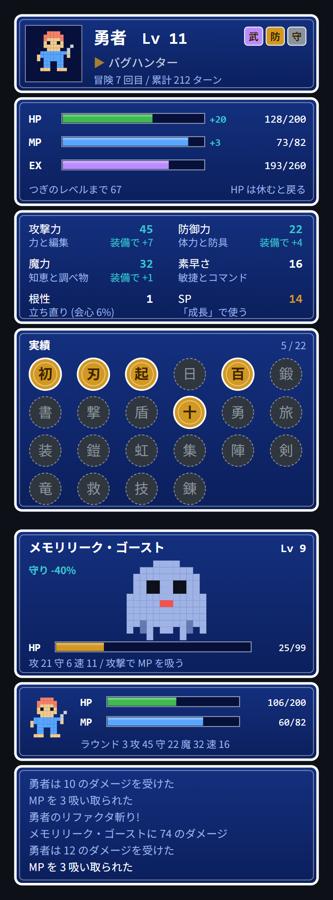

# Claude Code(冒険の書)

Claude Code で作業すると育つ RPG「冒険の書」(dev-rpg)と、ターンごとに引けるガチャ(turn-gacha)の 2 本です。
ガチャで出たカードは、冒険の書で武器・防具・お守りとして装備できます。

どちらも Claude Code の関数フック mod で、VS Code 拡張ではペインに SVG の絵で、ターミナルでは文字で表示します。

Anthropic とは関係のない、個人が作った非公式の mod です。

<table>
<tr>
<td align="center" valign="top"><b>dev-rpg(冒険の書)</b><br></td>
<td align="center" valign="top"><b>turn-gacha(ガチャ)</b><br></td>
</tr>
</table>

## 入っている mod

| mod | 呼び方 | 何をするか |
|---|---|---|
| dev-rpg | `/rpg` | 作業すると経験値がたまる RPG。レベル・称号・実績 22 個。ターンを終えるとたまる「魔物の気配」で魔物 8 種・ボス 3 体とボタンで戦う。ボスは時々湧き、湧いたボスは気配を使わずに挑めて経験値 1.5 倍。戦いで減った HP は 15 分休むか新しいセッションで戻る。レベル・実績・勝利・ボスで入る SP を能力(力・体力・知恵・敏捷)に振り、スキル 10 種を覚える。turn-gacha のカードを武器・防具・お守りに装備して能力が上がる |
| turn-gacha | `/gacha` | ターンが終わるたびにガチャ。N / R / SR / SSR のカード 40 種と図鑑、集まり具合の実績 6 個。出たカードは dev-rpg で装備にできる |

片方だけでも動きます。dev-rpg だけの時は、装備の画面に「turn-gacha を入れるとカードを装備できます」と出ます。

## 動作環境

- Claude Code 2.1.300 以降(関数フックの mod を読み込める版)
- VS Code で描くには、VS Code 拡張 2.1.300 以降が要ります。2.1.288 までの拡張は mod の描画に対応していません
- ターミナル・デスクトップアプリでも動きます。ターミナルでは SVG の代わりに文字だけの表示になります

## 入れ方

ターミナルの Claude Code の入力欄で:

```
/plugin install dev-rpg --marketplace takosasi-dev/claude-code-dev-rpg
/plugin install turn-gacha --marketplace takosasi-dev/claude-code-dev-rpg
```

`y` でマーケットプレイスを足し、スコープを選ぶと入ります。シェルからは:

```sh
claude plugin install dev-rpg --marketplace takosasi-dev/claude-code-dev-rpg
claude plugin install turn-gacha --marketplace takosasi-dev/claude-code-dev-rpg
```

デスクトップアプリでは、入力欄の横の + → Plugins → Add marketplace に `takosasi-dev/claude-code-dev-rpg` を入れ、Add plugin で選びます。

コマンドの名前がほかのプラグインや組み込みと被った時は、`/dev-rpg`・`/turn-gacha` のように mod の名前のコマンドになります。

## 気を付けること

- [claude-code-mods](https://github.com/takosasi-dev/claude-code-mods) にも同じ 2 本が入っています。あちらから入れている人は、こちらから入れないでください。両方から入れると `/rpg` や `/gacha` が 2 つずつ動きます
- dev-rpg の装備は turn-gacha 0.2.0 以降と一緒に入れた時だけ使えます。ガチャの図鑑から消えたカードは外れた扱いになりますが、記録は残ります
- Claude Code の theme を明るい物にしても、RPG の窓は絵の色のままです

## 自分で確かめるとき

```sh
claude plugin validate mods/dev-rpg
claude plugin test mods/dev-rpg
claude plugin test mods/turn-gacha
```

## 開発について

このリポジトリは claude-code-mods から 2 本だけを抜き出した写しです。直すのはいつも claude-code-mods の側で、リリースの時にこちらへ写します。不具合や要望は、どちらのリポジトリの Issue でも受け付けます。

## 開発状況

- テストは 2 本とも通っています(`claude plugin test`)
- VS Code 拡張 2.1.300 の実画面で、両方のペインが開くことを確かめています
- 関数フックの API はまだ先行公開の段階で、Claude Code の版によって変わることがあります

## ライセンス

MIT
